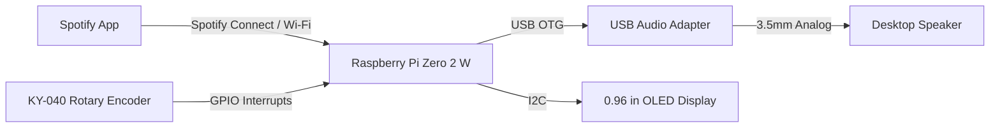

# Lenora

A standalone, headless desktop music player built on a Raspberry Pi Zero 2 W. Designed as a first-principles hardware and embedded Linux learning project, documented end-to-end as an open engineering log.

---

## Overview

The goal is to build a compact, tactile desktop audio unit that streams directly over Wi-Fi without relying on Bluetooth tethering or local MP3 storage. Every hardware decision, wiring mistake, and software trade-off is recorded chronologically in the engineering log.

### System Architecture

